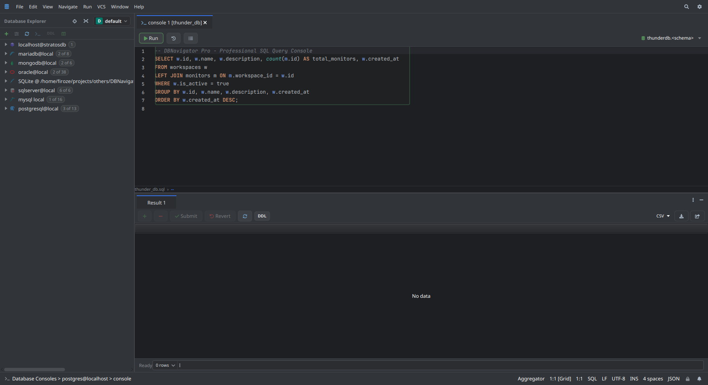
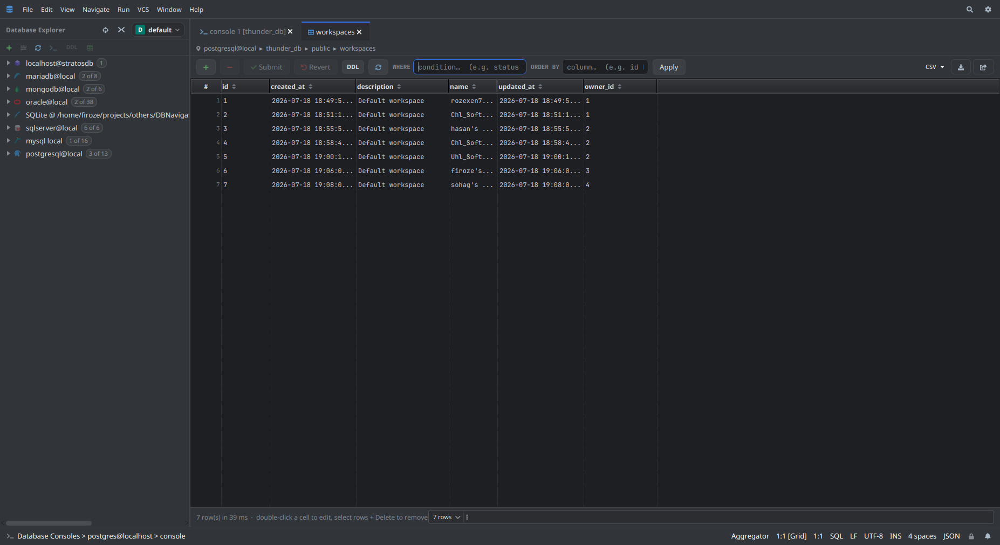
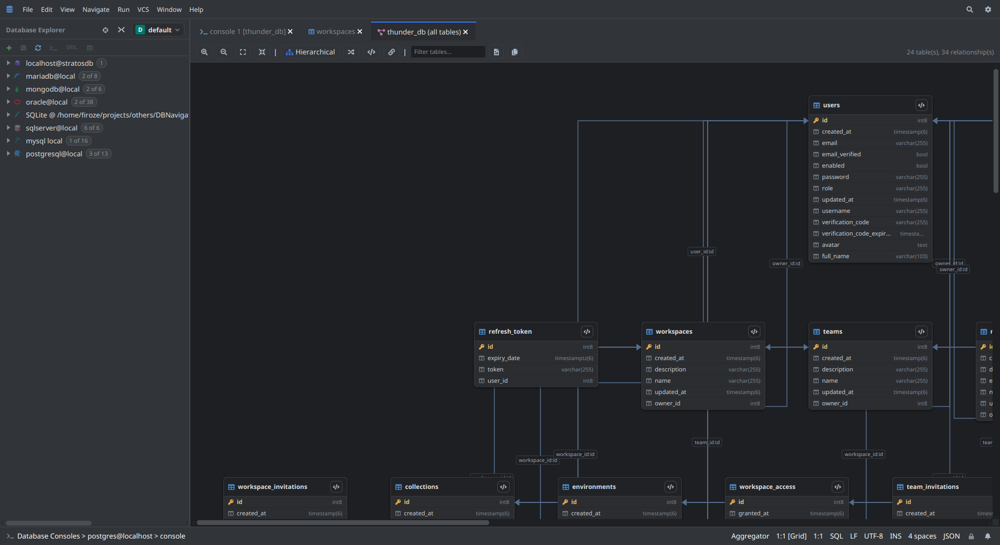
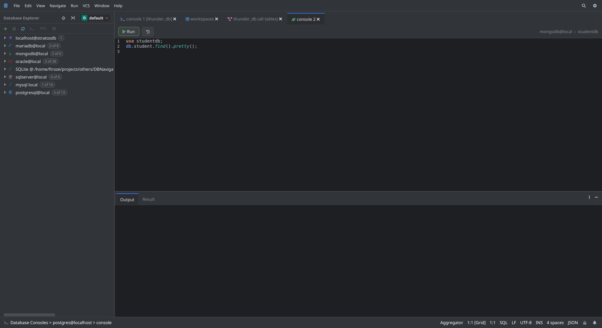

<div align="center">

# 🧭 DBNavigator Pro

**A modern, independent, and high-performance desktop database IDE built from scratch in JavaFX.**

One unified explorer, intelligent query console, interactive data editor, and visual ER diagram modeler for relational SQL databases and MongoDB.

[](https://github.com/firoze-hossain/DBNavigator/releases/tag/v1.0.0)
[-orange.svg?style=flat-square)](https://www.oracle.com/java/)
[](https://openjfx.io/)
[]()
[](LICENSE)

</div>

<br>

---

## 📸 Interface Preview

<table>
  <tr>
    <td align="center" width="50%">
      <br>
      <sub><b>Multi-Engine Database Explorer & SQL Query Console</b></sub>
    </td>
    <td align="center" width="50%">
      <br>
      <sub><b>Interactive Data Grid — Filtering, Sorting & Staged Edits</b></sub>
    </td>
  </tr>
  <tr>
    <td align="center" width="50%">
      <br>
      <sub><b>Whole-Database ER Diagram — Key Mapping & Relationship Routing</b></sub>
    </td>
    <td align="center" width="50%">
      <br>
      <sub><b>Native MongoDB Shell Console — Shell Syntax & Document Grid</b></sub>
    </td>
  </tr>
</table>

<br>

---

## 🌟 What is DBNavigator Pro?

**DBNavigator Pro** is an independent, developer-first desktop database management system engineered for performance, precision, and ease of use. Built natively with modern Java and JavaFX, it provides a desktop environment for software engineers, database administrators, and data analysts working across both relational SQL databases and document-oriented NoSQL stores.

Instead of switching between disconnected tools for different database engines, DBNavigator Pro brings **PostgreSQL, MySQL, MariaDB, Microsoft SQL Server, Oracle Database, SQLite, StratosDB, and MongoDB** into a single cohesive interface: the same schema tree, the same split-pane tab system, the same keyboard shortcuts, and the same transaction-safe data editing workflow.

<br>

---

## 🚀 Key Features

### 🗄️ Multi-Engine Schema Explorer
- **Asynchronous Lazy-Loading Tree**: Instant startup without network lag; schemas, catalogs, and metadata load on-demand when expanded.
- **Deep Metadata Inspection**: Inspect tables, views, stored procedures, functions, sequences, and MongoDB collections.
- **Rich Structural Details**: Table nodes expose primary keys, foreign key relations, secondary indexes, exact column types (e.g. `numeric(19,4)`, `timestamp(6)`), and partitions.
- **Context-Aware Object Actions**: Right-click any object to launch new query consoles, generate DDL, alter tables, drop objects with safety confirmation, or visualize diagrams.
- **Session-Scoped Credentials**: Secure, session-cached password handling so you never face repeated credential prompts during an active session.

### ⚡ Intelligent SQL Query Console
- **Statement Under Caret Execution**: Run queries with `Ctrl+Enter` (`Cmd+Enter` on macOS) without needing to highlight lines manually; precisely highlighted character range outlines the active statement.
- **Dynamic Parameter Substitution**: Seamlessly execute queries with named parameters (`:paramName`) through an interactive parameter binding dialog.
- **Live Autocomplete**: Schema-aware autocomplete for tables, columns, aliases, functions, and SQL keywords.
- **Server-Side Cursor Pagination**: High-efficiency streaming result sets that browse millions of rows without memory spikes or UI freezes.
- **Execution Plan Analysis (`EXPLAIN`)**: One-click visual query plan execution to profile indexes, execution paths, and query performance.
- **Local History & Bookmarks**: Automatic point-in-time snapshots of every executed query script, enabling rollback and diffing against earlier edits.

### 🍃 Native MongoDB Shell Console
- **Native Mongo Shell Syntax**: Execute commands directly using authentic shell syntax (`use database;`, `db.collection.find()`, `db.collection.insertOne()`) with unquoted keys and flexible quoting.
- **Rich Document Grid**: View documents in an expandable tabular grid or structured JSON document trees with nested object and array preservation.
- **Full Shell Method Support**: Integrated support for `find`, `findOne`, `insertOne`, `insertMany`, `updateOne`, `updateMany`, `deleteOne`, `deleteMany`, `countDocuments`, and `drop`.
- **Collection Introspection**: Inferred field catalogs sampled from live documents, including dotted notation for nested object attributes (e.g., `address.city`).

### 📊 Transaction-Safe Data Editor
- **Staged Inline Cell Editing**: Modify cells safely in-memory; changes are highlighted in color and staged until you review and click **Submit** or **Revert**.
- **Atomic Batch Submits**: Minimizes database round-trips by bundling edits into optimal single-statement `UPDATE` operations per altered row.
- **Real Database-Side Sorting**: Clicking column headers issues genuine `ORDER BY` queries against the server, sorting the entire dataset rather than merely sorting client memory.
- **Integrated WHERE & ORDER BY Clause Bar**: Filter and sort large tables on-the-fly with live column autocomplete inside the condition bar.
- **Export & Import**: Instant export to CSV, TSV, HTML, XML, Markdown, and JSON with formatting presets.

### 📐 Visual ER Diagrams
- **Whole-Database & Single-Table Diagrams**: Visualize complex database schemas at the click of a button.
- **Sugiyama Hierarchical Layout**: Automatic arrangement algorithms ensure logical parent-to-child entity flow.
- **Orthogonal Edge Routing**: Foreign key relationship lines route neatly between primary and foreign key columns without overlapping tables.
- **Interactive Canvas**: Smooth zooming, panning, entity dragging, minimap navigation, and high-resolution PNG diagram export.

### 🔍 Global Search Everywhere (`Shift + Shift` / `Ctrl + Shift + A`)
- Search across all connections, databases, schemas, tables, columns, procedures, and IDE actions in a single unified spotlight modal.
- Jump directly to schema objects, open query consoles, or execute application commands with keyboard-first speed.

### 🔄 Built-in Dual-Source Auto-Update Engine
- Automatic background version checks prioritizing official distribution channels with seamless fallback to GitHub Releases.
- Non-intrusive notification cards notify you of new features and critical patches.
- Instant release notes preview and direct one-click updates.

<br>

---

## 🗃️ Supported Database Engines

| Database Engine | Driver Type | Protocol / Driver | Supported Capabilities |
|---|---|---|---|
| **PostgreSQL** | Relational SQL | `org.postgresql:postgresql:42.7.4` | Schemas, Partitions, Sequences, `pg_dump`/`pg_restore`, Procedures |
| **MySQL** | Relational SQL | `com.mysql:mysql-connector-j:8.4.0` | Catalogs, Foreign Keys, `mysqldump`, Full Collation/Charset Support |
| **MariaDB** | Relational SQL | `org.mariadb.jdbc:mariadb-java-client:3.4.1` | Complete MariaDB syntax, Process list virtual views, DDL generation |
| **Microsoft SQL Server** | Relational SQL | `com.microsoft.sqlserver:mssql-jdbc:12.8.1` | Schemas, Identity columns, Execution plans, System process views |
| **Oracle Database** | Relational SQL | `com.oracle.database.jdbc:ojdbc11:23.5.0` | Schemas, Tablespaces, Packages, Sequences, PDB/SID connections |
| **SQLite** | Embedded SQL | `org.xerial:sqlite-jdbc:3.46.1.0` | Zero-configuration single-file databases, Full local query & data editing |
| **StratosDB** | Native Wire SQL | `com.github.firoze-hossain:stratosdb-jdbc:v1.0.9` | Native cluster wire protocol, SSL/TLS encryption, Multi-tenant routing |
| **MongoDB** | NoSQL Document | `org.mongodb:mongodb-driver-sync:5.2.0` | MongoDB Shell commands, Document JSON/Grid viewing, Index management |

<br>

---

## 📥 Downloads & Installation

Download the official binary for your operating system from the [**GitHub Releases**](https://github.com/firoze-hossain/DBNavigator/releases/tag/v1.0.0) page.

### 🍎 macOS Installation (Apple Silicon & Intel)

1. Download the macOS package (`DBNavigator-1.0.0.dmg` or `DBNavigator-1.0.0.pkg`) from [Releases](https://github.com/firoze-hossain/DBNavigator/releases/tag/v1.0.0).
2. Open the `.dmg` file and drag `DBNavigator.app` into your **Applications** folder.

#### ⚠️ Resolving macOS Gatekeeper ("Unidentified Developer" Warning)
Because DBNavigator is an independent open-source project and is not signed with an Apple Developer Program ID, macOS Gatekeeper may show a warning preventing you from launching the app on first run:

> *"DBNavigator cannot be opened because Apple cannot check it for malicious software"* or *"unidentified developer"*.

**How to open DBNavigator on macOS (choose any of the following methods):**

- **Method 1: Terminal (Quickest & Permanent)**
  Open your **Terminal** app and run:
  ```bash
  xattr -cr /Applications/DBNavigator.app
  ```
  *(This clears the macOS download quarantine attribute and allows DBNavigator to open immediately).*

- **Method 2: Finder Right-Click**
  1. Open **Finder** and navigate to your **Applications** folder.
  2. **Right-click** (or `Control` + Click) on `DBNavigator.app` and select **Open**.
  3. A prompt will appear with an **Open** button. Click **Open** to proceed.

- **Method 3: System Settings**
  1. Attempt to launch DBNavigator once.
  2. Open **System Settings** → **Privacy & Security**.
  3. Scroll down to the **Security** section.
  4. You will see: *"DBNavigator was blocked from use because it is not from an identified developer"*. Click **"Open Anyway"**.

---

### 🪟 Windows Installation (Windows 10 / 11 64-bit)

1. Download `DBNavigator-1.0.0.msi` or `DBNavigator-1.0.0-setup.exe` from [Releases](https://github.com/firoze-hossain/DBNavigator/releases/tag/v1.0.0).
2. Double-click the installer and follow the setup wizard.

#### ⚠️ Resolving Windows SmartScreen Notice
On initial launch, Microsoft Defender SmartScreen may display:

> *"Windows protected your PC — Microsoft Defender SmartScreen prevented an unrecognized app from starting."*

**How to proceed:**
1. Click the **"More info"** link on the SmartScreen prompt.
2. Click the **"Run anyway"** button that appears.

---

### 🐧 Linux Installation (Ubuntu, Debian, Fedora, Arch)

#### Debian / Ubuntu / Linux Mint (`.deb`)
1. Download `DBNavigator-1.0.0.deb` from [Releases](https://github.com/firoze-hossain/DBNavigator/releases/tag/v1.0.0).
2. Install via terminal:
   ```bash
   sudo dpkg -i DBNavigator-1.0.0.deb
   # If any dependency packages are missing, run:
   sudo apt-get install -f
   ```
3. Launch `DBNavigator` from your desktop application menu or by running `dbnavigator` in terminal.

#### Portable Tarball (`.tar.gz`)
```bash
tar -xzf DBNavigator-1.0.0-linux-x64.tar.gz
cd DBNavigator
./bin/DBNavigator
```

<br>

---

## 🛠️ Building From Source

If you prefer to compile and run DBNavigator Pro from source:

### Prerequisites
- **JDK 21** or later (Oracle JDK or OpenJDK, Java 25 supported)
- **Maven 3.9+**
- Git

### Build & Run
```bash
# 1. Clone repository
git clone https://github.com/firoze-hossain/DBNavigator.git
cd DBNavigator

# 2. Run directly with JavaFX Maven plugin
mvn clean javafx:run

# 3. Or package into an executable JAR:
mvn clean package
java -jar target/DBNavigatorPro-1.0.0.jar
```

<br>

---

## 🤝 Open Source Contribution

Contributions make the open-source community an incredible place to learn, inspire, and create. Any contributions you make to **DBNavigator Pro** are **greatly appreciated**!

### How You Can Contribute
- **Bug Reports**: Open an issue describing the unexpected behavior, including your OS version, database engine, and step-by-step reproduction instructions.
- **Feature Requests**: Suggest new capabilities, database engine integrations, or ergonomic UI enhancements.
- **Code Contributions**: Submit pull requests for bug fixes, performance optimizations, or new features.

### Pull Request Workflow
1. **Fork** the project repository.
2. Create your feature branch (`git checkout -b feature/AmazingFeature`).
3. Commit your changes (`git commit -m 'feat: Add support for custom SQL snippets'`).
4. Push to your branch (`git push origin feature/AmazingFeature`).
5. Open a **Pull Request** detailing your changes, motivation, and any testing performed.

<br>

---

## 📄 License

This project is licensed under the **MIT License** — see the [LICENSE](LICENSE) file for details.

<br>

<div align="center">
<sub>Crafted with passion for database developers worldwide. DBNavigator Pro is an independent project.</sub>
</div>
